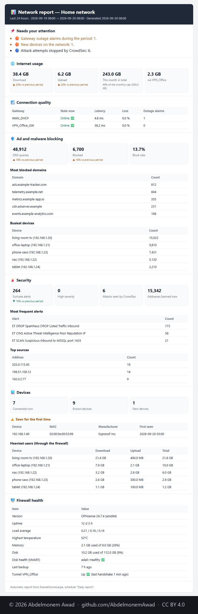
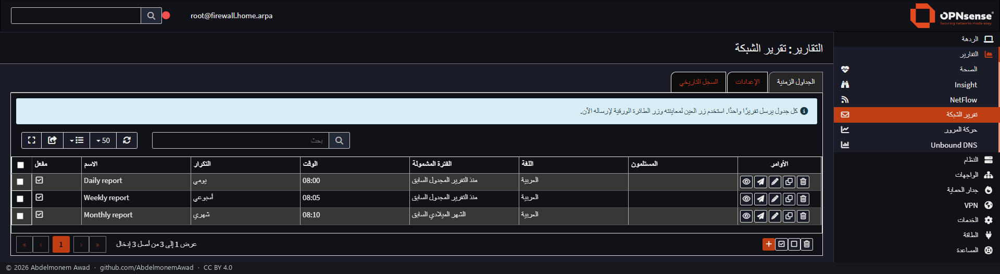
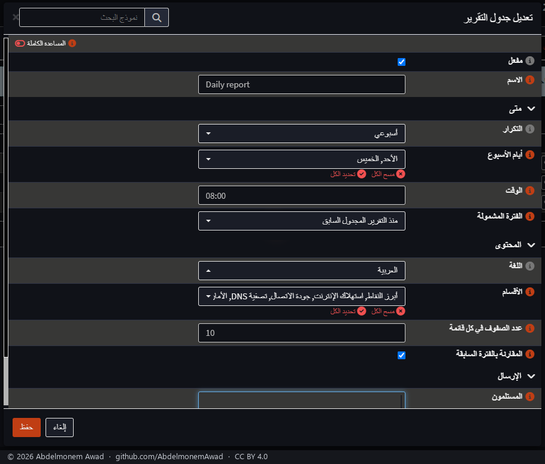

<picture>
  <source media="(prefers-color-scheme: dark)" srcset="docs/images/readme/banner-dark.svg">
  <source media="(prefers-color-scheme: light)" srcset="docs/images/readme/banner-light.svg">
  
</picture>

<p align="center">
  <a href="https://github.com/AbdelmonemAwad/os-netreport/releases/latest"></a>
  <a href="https://github.com/AbdelmonemAwad/os-netreport/actions/workflows/checks.yml"></a>
  <a href="LICENSE"></a>
  <a href="#network-report-for-opnsense"></a>
  <a href="https://github.com/AbdelmonemAwad/opnsense-arabic"></a>
  <a href="https://github.com/AbdelmonemAwad/os-xgs-npu"></a>
</p>

# Network Report for OPNsense

A plugin that emails a summary of your network on a schedule: how much data went through the
internet connection, whether the gateways dropped, what the DNS blocklists caught, what the IDS
saw, which devices were busiest, and how the firewall itself is doing.

I wanted something I could read over coffee instead of opening five pages of the GUI every
morning, so the report is a single HTML mail with the things that need attention at the top.

Tested on OPNsense 26.7.



*A daily report (sample data).*

<p align="center"><b>Contents:</b> <a href="#what-is-in-a-report">What is in a report</a> &middot; <a href="#features">Features</a> &middot; <a href="#alerts">Alerts</a> &middot; <a href="#screenshots">Screenshots</a> &middot; <a href="#where-the-data-comes-from">Where the data comes from</a> &middot; <a href="#installation">Installation</a> &middot; <a href="#how-it-works">How it works</a> &middot; <a href="#translations">Translations</a> &middot; <a href="#known-limitations">Known limitations</a> &middot; <a href="#in-the-xgs-image">In the XGS image</a> &middot; <a href="#updates">Updates</a> &middot; <a href="#license">License</a></p>

## What is in a report

- **Needs attention**: gateway down or losing packets, outage alarms, new devices, high severity
  IDS alerts, temperature or disk above a threshold, SMART problems, an old configuration
  backup, the monthly data cap getting close.
- **Internet usage**: download and upload for the period, month to date, traffic through VPN
  tunnels, compared with the previous period.
- **Connection quality**: state, latency and loss of each monitored gateway, outage alarms in
  the period.
- **DNS filtering**: queries, blocked queries, most blocked domains, busiest clients.
- **Security**: Suricata alerts by signature and source, CrowdSec alerts and active bans.
- **Devices**: devices online, devices seen for the first time (with the manufacturer), and the
  heaviest users.
- **Firewall health**: version, uptime, load, temperature, memory, disk, SMART, last backup,
  VPN tunnel state.

Each schedule picks which of these sections it includes.

## Features

- Any number of schedules: daily, on selected weekdays, or on a day of the month (including the
  last day). Each has its own time, period, language, sections and recipients.
- The period defaults to "since the previous scheduled report", so nothing is counted twice.
  Fixed periods (24 hours, 7 days, 30 days, previous calendar month, month to date) are also
  available.
- Reports in all 21 languages of the OPNsense GUI, or in whatever language the GUI is set to.
  Arabic and Persian reports are laid out right to left.
- Optional "only when something needs attention" mode, which skips quiet days.
- Alerts as things happen, by mail, a webhook or ntfy: a gateway or a VPN tunnel down and back,
  repeated failed logins, intrusion alerts, a device reaching a command-and-control list, a
  restart the hardware watchdog caused, a device joining the LAN for the first time (see
  [Alerts](#alerts)).
- If the firewall is off at the scheduled time, the report goes out when it comes back (up to
  12 hours late).
- Preview and "send now" buttons, a history of everything sent, and copies of sent reports kept
  on the firewall for a configurable number of days.
- Mail goes through the SMTP server already configured for Monit, or a separate one.

## Alerts

Besides the scheduled reports, the plugin sends an alert as soon as something happens. Every alert
goes through one layer (`alerts.py`), which hands it to each channel that is set; a channel that
fails does not stop the others, and each try is a line on the History tab with the result per
channel. All alerts are on by default (Settings tab, section *Alerts*; *Send alerts* turns them all
off). They are written in the *Alert language*, with times in the firewall's local time.

| Alert | When | Setting (default) |
| --- | --- | --- |
| Gateway down / back | A monitored gateway's state (dpinger, as **System → Gateways** shows it) has changed and held on two reads a minute apart: "down since" the first read that saw it, "back after" how long it was down. More than 3 changes in 15 minutes is one "flapping" alert instead, and nothing more until one state has held for 15 minutes. The changes counted are the raw reads, before the two-reads rule, on purpose: two one-minute blips within 15 minutes (four changes) are flapping. Gateways with monitoring off are skipped. | `gateway_alert` (on) |
| Repeated failed logins | One address failed to sign in to the web GUI, the API or SSH `login_fail_count` times within 10 minutes; the alert gives the count, the services, and how many different user names were tried with at most three of them cut to their first two characters (people type a password into the user field, so the names are never sent as they are). Every failed SSH try counts, several on one connection too; sshd's "Invalid user" and PAM's error beside a "Failed" line are the same try, and "Failed publickey" is not counted (an agent offering several keys logs it routinely). The address is the one at the end of the line, so a user name holding an address cannot put it in the alert. Then quiet for that address for 30 minutes. A failed API key is not counted: OPNsense logs no address for it. | `login_alert` (on), `login_fail_count` (5) |
| Intrusion alert | Suricata logged an alert of high severity (or high and medium) in `eve.json`: one alert per signature and source with the action (allowed or blocked), the destinations and the count, then quiet 30 minutes for that pair. | `ips_alert` (on), `ips_severity` (high only) |
| VPN tunnel down / back | An IPsec connection has no IKE session ESTABLISHED with a child SA INSTALLED (one still connecting, a peer that does not answer, is not up), a WireGuard peer's last handshake is 180 seconds old or older, an OpenVPN instance configured and enabled is not running (it exited, and took its management socket with it), its socket refuses, or a client instance is not connected; a server that is not running or refuses takes its clients down with it, and a client that left its server is down - with the same two reads as the gateways. A connection that has not been up since the plugin started following it is not reported down; a command that fails is unknown, never down. | `vpn_alert` (on) |
| Hardware watchdog reset | os-watchdog recorded that the hardware watchdog caused the last restart (`/var/db/os-watchdog/reset-reason.json`); one alert per boot, with the reasons. | `watchdog_alert` (on) |
| Command-and-control list | A device of the firewall's own networks (IPv4 or IPv6) tried to reach an address on a command-and-control list that os-blocklists blocks with its log on, on its rule `Block Lists: blocklists_<id> out` or `... from inside`; one alert the first time an address is seen, with its name and MAC where they are known, the list, the destination and the time. The device is also listed in the report's security section. | `c2_alert` (on) |
| From other XGS plugins | What os-xgs-npu leaves for this plugin (below). | `xgs_alert` (on) |
| New device | A device joined the local network for the first time (within five minutes). | `new_device_alert` (on) |

Each collector's first run only records where things are (log offsets, states, the last id), so
installing the plugin does not alert on old history (os-xgs-npu's alert files are the exception:
they are left there to be taken, and those already waiting are sent on the first run); with an alert off its collector still keeps
its place, so turning it on does not send the backlog.

Limits on each minute's pass, so that a storm or a pause does not flood the channels:

- One collector sends at most 10 alerts a minute. Past that, the rest are not sent: one line in
  the history says how many, for that collector and minute, however many they are ("Skipped", "N
  alerts of this kind held this minute (more than 10)", with the first five subjects), so a storm
  cannot push the rest of the history (its last 500 lines) out; and one more alert says how many:
  "N more alerts of the same kind", see the history. os-xgs-npu's alert files and
  anomalies (below) are not dropped at the cap: those past it wait for the next minute, with no
  history line. New alert files and new anomalies go first, and the retries of files and
  anomalies that failed after both, so the retries cannot crowd out what is new.
- The whole pass has 45 seconds. Collectors not yet run by then wait for the next minute; their
  places in the logs do not move, so nothing is lost.
- When the last pass is more than 10 minutes old (the plugin was off, the firewall was down), the
  log readers - failed logins, intrusion alerts, command-and-control - start again from the end of
  their logs, as on a first run. And whatever they read, a log line whose own time is more than 10
  minutes old is not alerted.

### Channels

- **Mail** (`alert_mail`, on): the report's own mail server (Monit's or the custom one) and default
  recipients, as an HTML mail.
- **Webhook** (`alert_webhook_url`, empty = off): each alert is POSTed as JSON
  `{"source": "os-netreport", "host", "kind", "at", "subject", "text", "facts"}`, with one optional
  header line (`alert_webhook_header`, for example an `Authorization` header; kept on the
  firewall like a password, not shown again, and left as it is when the field is saved empty), a
  10 second timeout on each step and 15 seconds for the whole request (as for ntfy: a server that
  answers a byte at a time cannot hold the minute's pass), and the server's certificate checked.
- **ntfy** (`alert_ntfy_server` and `alert_ntfy_topic`, both empty = off): the plain text POSTed to
  `<server>/<topic>` with ntfy's `Title`, `Priority` and `Tags` headers, and `alert_ntfy_token` as
  a bearer token when set. There is no default server, on purpose: a public server by default
  would send the firewall's events out by itself. On a public server anyone who knows the topic
  can read it.

A webhook or ntfy server that answers with a redirect is not followed (the header or the token
would go along to whatever host it names): any 3xx is a failure, "the server answered with a
redirect to ...", which names only the scheme and host it points to (`https://host`): its path
and any user name or password are left out of the history and the system log, since a webhook's
address may carry its secret in the path. Only the reply's status is read, not its body.

*Send a test alert* on the Settings tab sends one to every channel that is set and shows what each
one answered (`configctl netreport testalert` does the same from a shell).

The same alert (its kind and key) is not sent twice within its quiet time, 30 minutes unless said
otherwise above. What the layer remembers - quiet times, log offsets, states - is in
`/var/db/netreport/alerts-state.json`.

### Files shared with other plugins

- **Taken from os-xgs-npu** (neither existing is normal):
  - `/var/db/os-xgs-npu/alerts/*.json`, one alert a file
    (`{"source", "kind", "at", "subject", "text", "facts"}`): sent, then removed; kept while every
    channel fails and tried again each minute, and removed after 24 hours; a file is removed
    only once it was sent or is 24 hours old. Files already waiting
    when the plugin first runs are taken too, on purpose: they are left there to be taken. A
    retry is silent: the history has one line at the first failure, one when a send succeeds,
    and one when the file is dropped. Only regular files are taken: a symbolic link is not
    followed (nor sent, nor removed), and a file is removed only if it is still the one that was
    read (the same inode and size), so an alert written over it in the meantime goes the next
    minute.
  - `/var/db/os-xgs-npu/anomaly/alerts.jsonl`, one `{"id", "at", "host", "kind", "message",
    "source"}` a line, `id` counting up from 1: what is above the last id sent is sent; ids all
    below it mean the file was started again, and it is read from the start. An anomaly no
    channel took is kept and tried again each minute like the files above (the same history
    lines), and dropped after 24 hours. The last id moves one anomaly at a time, as each is
    taken, so one that cannot be sent (it stays pending) or a run stopped half way loses none
    after it. `at` is ISO 8601 or Unix seconds (milliseconds are recognised); an anomaly with a
    time that is not one is sent with the time it was read.
- **Written for os-portguard**: `/var/db/netreport/infected.json`,
  `{"<address>": {"first", "last", "count", "list", "mac", "name"}}` - the addresses of the
  firewall's own networks that os-blocklists blocked on their way to a command-and-control list
  (never one of the firewall's own addresses), the times in Unix seconds, the os-blocklists feed id,
  and the device's MAC and name where they are known. An entry whose last blocked connection is
  more than 7 days old is dropped; the file is written whole. A command-and-control list is a feed
  of os-blocklists marked `"c2": true` in its `feeds.json`, and until os-blocklists marks them,
  `feodo` (abuse.ch Feodo Tracker). The file is removed with the plugin.

### Where the alerts are read from

| Alert | Source |
| --- | --- |
| Gateways | `pluginctl -r return_gateways_status` (dpinger) |
| Failed logins | `/var/log/audit/audit_YYYYMMDD.log`. For every failed login of the web GUI, of the API's user and password or of another service, OPNsense 26.7 writes one warning under the program `audit`: `user <name> could not authenticate for <service>. [using <service class> + <authenticator class>] at <address>`; that line is counted, once, and its service goes into the alert. Not counted: the debug line OPNsense may write before it (`... failed authentication for ...`), the login page's `Web GUI authentication error for '<name>' from <address>` (the same try), and `... could not authenticate for <service>, failed constraints on ...` (the right password for an account that is disabled or expired). A failed API key is logged as `uri ... authentication failed for api key ...`, with no address, so it cannot be counted per address and is not counted at all. sshd's failures are there too (facility auth), under the program `sshd` or `sshd-session` (OPNsense 26.7). A line is read only by the patterns of its program: the `audit` line by the web GUI's, sshd's by the SSH ones. When password logins are allowed, OPNsense's "System" authentication also answers for the PAM services (`sshd`, `login`, `su`, `sudo`), and `audit` may then write its line for `sshd` beside sshd's own `Failed password` line of the same try: the `audit` line is not counted for those services, so SSH is counted from sshd's lines alone. The audit log's destination folds a line repeated within seconds into "Last message '...' repeated N times"; such a line counts as N more of the line it folds, but only when it directly follows that line in the same file (syslog-ng writes it there): after the reader started again (a pause, a rotated file, a log grown too fast to read whole) or with another line between them, a fold counts nothing, so it cannot multiply a line read long before. |
| Intrusion alerts | `/var/log/suricata/eve.json` |
| VPN tunnels | `configctl ipsec list status`, `configctl wireguard show`, `configctl openvpn connections client,server`. Which OpenVPN instances there are comes from `/conf/config.xml`: the instances of the OpenVPN model (`OPNsense/OpenVPN/Instances/Instance`, `enabled` 1, by uuid) and the legacy servers and clients (`openvpn/openvpn-server`, `openvpn/openvpn-client`, without `disable`, by vpnid). One that is neither there nor listed by configctl has been removed and is forgotten. |
| Command-and-control | `/var/log/filter/filter_YYYYMMDD.log` (folded lines given back as for the audit log), the rule's description from `/tmp/rules.debug` (the way the firewall's live log names its rules) |

## Screenshots

The GUI below is shown in Arabic, with the right-to-left layout from
[opnsense-rtl](https://github.com/AbdelmonemAwad/opnsense-rtl); in English it is laid out the usual way.

| Schedules | Editing a schedule |
| --- | --- |
|  |  |

The same report in Arabic: [docs/images/report-ar_SA.png](docs/images/report-ar_SA.png).

## Where the data comes from

The plugin does not collect anything itself; it reads what OPNsense already records. Sections
whose source is missing simply show "no data".

| Section | Source | Needed |
| --- | --- | --- |
| Internet usage | vnstat | `os-vnstat` plugin |
| Connection quality | dpinger gateway monitoring, system log | gateway monitoring enabled |
| DNS filtering | Unbound query database | Unbound with reporting enabled |
| Security | Suricata `eve.json`, `cscli` | Intrusion Detection, `os-crowdsec` (optional) |
| Devices | ARP table, host discovery, NetFlow | Insight (NetFlow) for per-device usage |
| Firewall health | sysctl, `smartctl`, system log | `os-smart` for SMART (optional) |

## Installation

The plugin is not in the OPNsense plugin repository yet, so there is no
`pkg install os-netreport`. There is a package, and you build it — on the firewall,
from this repository, in one command. Building needs no root and installs nothing.

```sh
fetch -o /tmp/netreport.tar.gz https://github.com/AbdelmonemAwad/os-netreport/archive/refs/heads/main.tar.gz
tar -xzf /tmp/netreport.tar.gz -C /tmp
cd /tmp/os-netreport-main
sh tools/make-package.sh -o /tmp -c net
```

It tells you where it put the package, its digest, and which commit it came from:

```
/tmp/os-netreport-1.0.pkg
SHA256 fa87eefb3acd9c1d2094e00e7816a84ae2f52804fb5c195cecea9f64b5f1c417
commit 3ba5f0ad1
built on OPNsense 26.7 amd64
```

The digest is of the file you just built. Two builds of the same commit do not
produce the same digest unless the commit date is passed in, because otherwise every
file in the archive carries its own mtime:

```sh
SOURCE_DATE_EPOCH=$(git log -1 --format=%ct) sh tools/make-package.sh -o /tmp
```

Read it before you install it. Nothing about a package file makes it trustworthy, and both of
these questions are answered out of the file itself, without touching the machine:

```sh
pkg info -F  /tmp/os-netreport-*.pkg      # version, licence, dependencies, description
pkg info -lF /tmp/os-netreport-*.pkg      # every file it will write, and it writes no others
```

Then, as root:

```sh
pkg add /tmp/os-netreport-*.pkg
```

Then open **Reporting → Network Report** (**XGS → Network Report** when os-xgs-npu is installed),
check the mail settings on the Settings tab
(the *Save and send test message* button is the quickest way), and add a schedule.

A newer version goes on over an installed one with `pkg add -f`. Settings in `config.xml` and
state under `/var/db` survive, because pkg replaces only the files the package owns.

<details>
<summary>Installing by hand instead, with no package</summary>

`install/install.sh` does the same work and is what existed before there was a package:

```sh
fetch -o /tmp/netreport.tar.gz https://github.com/AbdelmonemAwad/os-netreport/archive/refs/heads/main.tar.gz
tar -xzf /tmp/netreport.tar.gz -C /root
sh /root/os-netreport-main/install/install.sh
```

The difference is only in the bookkeeping: pkg does not know the files are there, so
`opnsense-version -c os-netreport` answers *not installed* on a machine where the plugin is
running, and removal is `install/uninstall.sh` rather than `pkg delete`.

</details>

### Removing it

```sh
pkg delete os-netreport
```

Settings stay in `config.xml` and the history in `/var/db/netreport`, so a reinstall
picks up where it left off. The alerts' places in the logs (`alerts-state.json`) and
`infected.json` go with the plugin: a later install starts from where the logs are then.

### What a package outside the OPNsense repository does not get

It is not upgraded by **System → Firmware → Updates**, because that only offers what the
OPNsense repository carries, and this is not in it. A firmware update does not remove it —
the files are pkg's, and OPNsense does not delete packages it did not install — but it will
not be updated either. Build a new package from a newer tag and `pkg add -f` it.

## How it works

- `src/opnsense/scripts/netreport/netreport.py` builds and sends the reports. Cron runs it every
  minute (`/usr/local/etc/cron.d/netreport`); it runs the alert collectors, sends whatever is due
  and scans the LAN for new devices every five minutes.
- `src/opnsense/scripts/netreport/alerts.py` is the alert layer and its collectors (see
  [Alerts](#alerts)); `alerts.py test` sends a test alert.
- The GUI (model, controllers, view) follows the usual OPNsense MVC layout. Settings are stored
  under `OPNsense/NetReport` in `config.xml`.
- Report texts live in `i18n/<locale>.json`, Arabic among them. The GUI's Arabic is in
  [opnsense-arabic](https://github.com/AbdelmonemAwad/opnsense-arabic)'s catalogue with the rest of
  the GUI since 2026-10-22. GUI strings for the other languages are
  in `i18n/ui/<locale>.json` and are merged into the system catalogs by
  `merge_ui_translations.py`, which also runs when pkg writes a catalog
  (`/usr/local/share/pkg/triggers/os-netreport.ucl`) and at boot, because core updates replace
  those catalogs and an update that only installs packages does not reboot. A string a catalog
  already translates keeps OPNsense's words, unless the merge wrote it itself: what it wrote is
  recorded in `/var/db/netreport/i18n-owned.json`, and takes a corrected translation from a later
  release. Once the plugin is part of the official repository this step goes away, since its
  strings would then be translated through the normal OPNsense process.
- State, history and archived reports are kept in `/var/db/netreport`.

## Translations

English and Arabic are complete and in daily use. The other languages are first versions and
would benefit from a native speaker's review; corrections are welcome as pull requests.
`install/check_i18n.py` checks that every language file has the same keys and placeholders as
the English one.

## Known limitations

- Per-device usage only covers traffic that passes through the firewall; traffic between two
  devices on the same switch is not seen.
- The "new device" list relies on the ARP table, so devices that are only on IPv6 are not
  detected.
- A WireGuard peer counts as up while its last handshake is less than 180 seconds old. A peer
  that carries no traffic and has no persistent keepalive set handshakes less often, and reads as
  down; set a keepalive on such a peer, or turn the VPN alert off.
- The command-and-control alert needs os-blocklists' rule `Block Lists: blocklists_<id> from
  inside` (its next release adds one for every command-and-control feed) for devices behind the
  firewall's outbound NAT. pf matches os-blocklists' outbound rule (`... out`) after NAT and logs
  the firewall's own address as the source there (seen on an appliance: three tries out of three),
  which names no device and is left out; the `from inside` rule matches where the packet enters
  the firewall, before NAT, with the device's own address.
- Some languages change word forms with the number (Polish, Russian, Ukrainian and others).
  The wording was chosen to read well for most numbers, but not every count is grammatically
  perfect.

## In the XGS image

[xgs-image-builder](https://github.com/AbdelmonemAwad/xgs-image-builder) builds an OPNsense image
for Sophos XGS appliances with this repository in it, installed at the image's first boot. It holds
no copy of this repository: every build takes `main` as it is that day, so a change merged here is
in the next image without anything being done there. What the image calls here - `install/install.sh` - is checked
from that side every day, so moving or renaming one of them is caught there; keep them where they are.

## Updates

An installed copy is updated to this repository's **releases** by hand: from **XGS: Updates**, its *Plugins*
tab ([os-xgs-npu](https://github.com/AbdelmonemAwad/os-xgs-npu)), or with `/usr/local/opnsense/scripts/netreport/self-update.py`.
Nothing is installed on its own since 2026-10-20: an update runs when the appliance's owner starts it. It reads the
latest release's signed manifest and, when the release is ahead of what is installed, downloads the archive the
manifest names and runs the `install/install.sh` it carries - the same script a hand install runs. A change merged
on `main` reaches installed firewalls when it is released, not before; with no release published, nothing changes.

- **Signed releases** (since 2026-11-07). A release is installed only as its owner signed it. It carries
  `os-netreport-<tag>.tar.gz`, the tag's tree made by `git archive`; `release.json`, the manifest - the tag, its
  commit and date, the archive's SHA-256 and size; and `release.json.sig`, the manifest's Ed25519 signature, made by
  the owner's private signing repository, never by this repository's CI. The public keys are installed in
  `/usr/local/opnsense/scripts/netreport/release-keys/`. A release whose signature does not verify with one of them,
  or whose archive is not the one signed, is not installed, and a release not signed is not offered. GitHub's API
  and npuforge.org's copy of it no longer choose what is installed, and the tag's commit is confirmed with GitHub
  before the download. A release is made a draft by `release.yml` and published only once it is signed.
- **Only forward.** What is installed is recorded in `/usr/local/share/os-netreport/installed.json` by
  the installer - the commit, from a git checkout or from the `.source-commit` stamp that an
  xgs-image-builder image or an update leaves in the tree. A firewall running something newer than
  the release - by the date signed - is not taken back; an install from before the stamp existed takes the
  latest release once.
- **What happened** is in the system log as `self-update`, in
  `/usr/local/share/os-netreport/update.json`, and the installer's output in `update.log` beside it.
- `/usr/local/opnsense/scripts/netreport/self-update.py check` says what it would do and changes nothing.

Tested by `tools/test-self-update.py`, which the checks run - releases made and signed in the test with
throwaway keys: what is taken and refused, and what an update installs - and on an XGS 3300 through the
*Plugins* tab: [signed releases, measured](docs/signed-releases.md).

## License

BSD 2-Clause, the same as OPNsense. See [LICENSE](LICENSE).

The photographs and screenshots under `docs/` are &copy; 2026 Abdelmonem Awad, under [CC BY 4.0](https://creativecommons.org/licenses/by/4.0/): use them freely, naming the author and linking here. Each carries that notice in a strip added below it.
