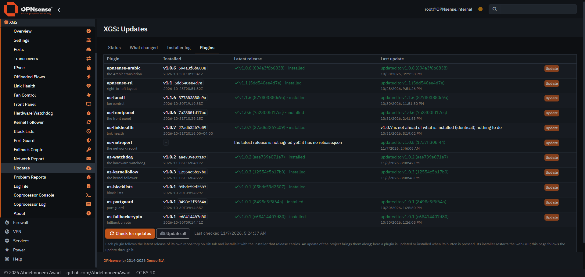
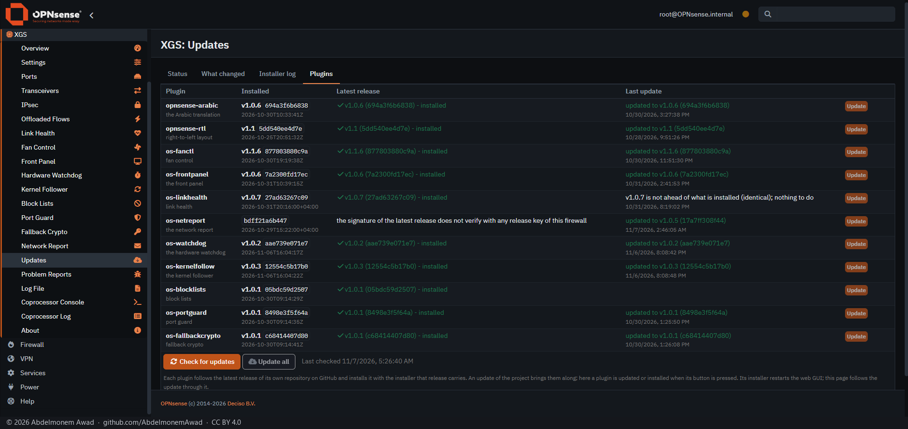
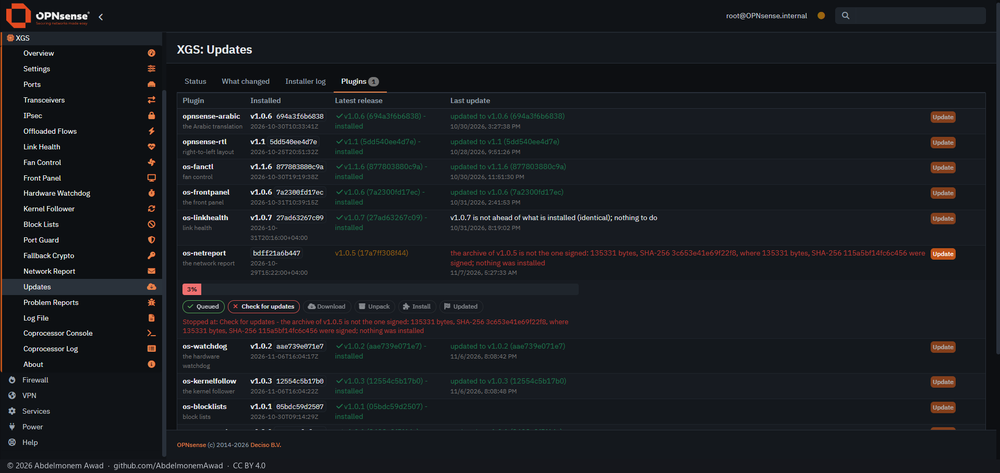
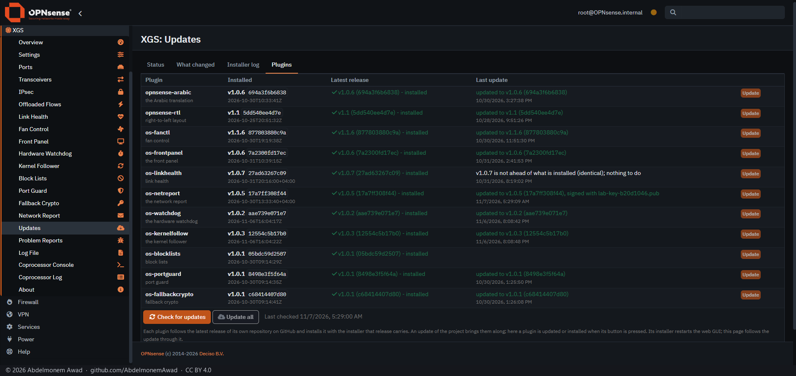

# Signed releases, measured on an XGS 3300

Since 2026-11-07 `self-update.py` installs a release only as its owner signed it ([README: Updates](../README.md#updates)).
This is that change run on the first XGS 3300 of the lab on 2026-11-07, 01:24 to 01:30 UTC, through
**XGS: Updates**, its *Plugins* tab, the way an owner meets it: the tab's Check, and its Update.

**What ran.** The change's own tree - the branch's files, archived by `git archive` and installed by the
`install/install.sh` it carries, as a hand install does - on OPNsense 26.7 with Python 3.13 and OpenSSL 3.5.7, and
os-xgs-npu's Plugins tab as main had it that day. The installed `release-keys/` held the project's release key
alone.

**The release.** A release cannot be published on GitHub for a test, so the plugin read one from a place of the
lab's, named in `/usr/local/share/os-netreport/releases-from` (`file://`): v1.0.5 - its archive made by `git archive`
from its tag, 135331 bytes, its manifest, and the manifest's signature, made with a throwaway key of the lab's whose
public half stood in for the release key while the test ran. What was installed was said to be v1.0.4, so that
v1.0.5 was offered.

| | The latest release | The Check said | The Update did |
|---|---|---|---|
| 1 | GitHub's own v1.0.5, published before releases were signed | the latest release is not signed yet: it has no release.json | not offered |
| 2 | v1.0.5 signed with the lab's key, which the firewall did not hold | the signature of the latest release does not verify with any release key of this firewall | not offered |
| 3 | v1.0.5 without its release.json | the latest release is not signed yet: it has no release.json | not offered |
| 4 | v1.0.5 signed, one byte of its archive changed | offered | the archive of v1.0.5 is not the one signed: 135331 bytes, SHA-256 3c653e41e69f22f8, where 135331 bytes, SHA-256 115a5bf14fc6c456 were signed; nothing was installed |
| 5 | v1.0.5 as signed | offered | updated to v1.0.5 (17a7ff308f44), signed with lab-key-b20d1046.pub - 7 s from the button |

After 4, `installed.json` still named v1.0.4's commit, and the update had left nothing in `/var/tmp`. After 5 it
named v1.0.5's, `17a7ff308f44`, with the date signed, `2026-10-30T13:33:40+04:00`, and `update.log` began:

```
Sat Nov  7 01:29:07 2026: installing v1.0.5 (17a7ff308f44f5c93485b1966694740b8a82df26), signed with lab-key-b20d1046.pub; the archive is the one signed: 135331 bytes, SHA-256 115a5bf14fc6c456
```

The tag's commit was confirmed with GitHub's own list of references before the download in 4 and 5. v1.0.5's tree
carries the `self-update.py` from before releases were signed, so the update of 5 left the plugin as it was before
the test; the lab's files, its place and its key were then taken away.

**1. GitHub's v1.0.5, not signed**



**2. Signed with a key the firewall does not hold**



**4. One byte of the archive changed: refused, nothing installed.** The bar stopped at *Check for updates*: the
tab follows the files an update leaves in `/var/tmp`, and an archive read from a local place in under half a
second was gone before it looked; the message is the update's own.



**5. As signed: installed**



The same, and more, without a firewall: `tools/test-self-update.py` makes releases and signs them with throwaway
keys - what a check takes and refuses, which release is taken against what is installed, what an update installs,
and nothing installed when the archive is not the one signed or the tag has moved. The checks run it on every
change.
